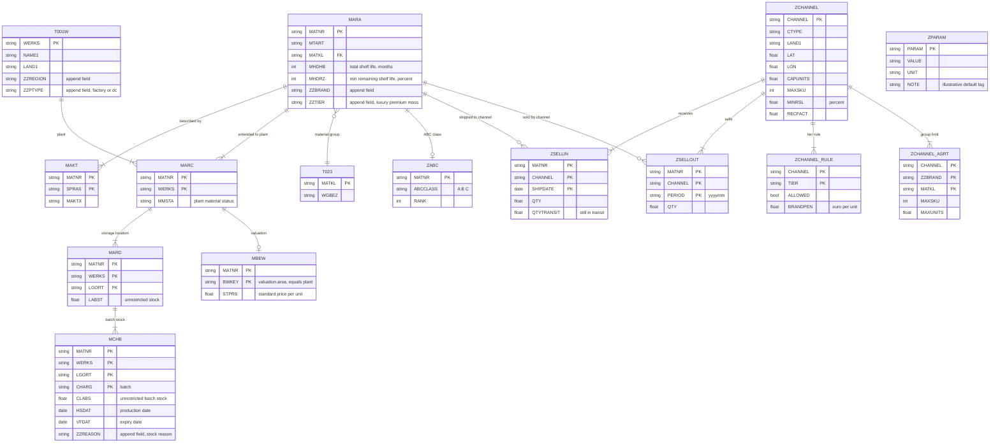
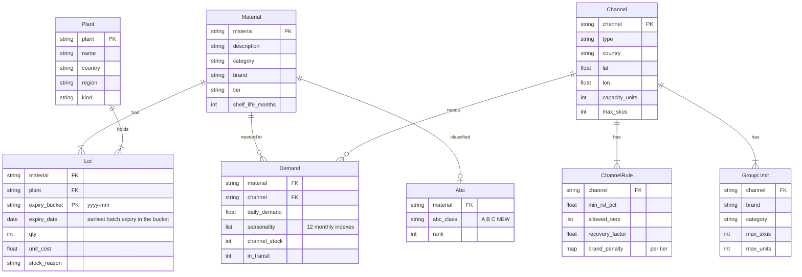

# Entity relationship diagrams

Evidence level: design, no code yet. All table content is synthetic (Kestrel Beauty Group). Only standard SAP table and field names are used, plus custom `Z` tables and `ZZ` append fields, which is the usual SAP convention. Every value the generator writes is an illustrative default.

The solver never reads the source layer. The path is source tables, then a `SourceAdapter`, then the canonical dataset, then the solver input. Field level rules are in `mapping.md`.

## 1. Source layer (SAP style)

Notes on the custom pieces:

* `ZCHANNEL_ASRT` is new compared with `docs/war_plan.md` section 4.2. It holds the group limits `A_{g,c}` (SKUs) and `U_{g,c}` (units, the Q8 decision, 2026-10-25) per channel and group, where a group is brand by category.
* A plant is either a factory or a distribution center. Distribution centers are plants of their own (`ZZPTYPE = dc`), which is how SAP models them, so the decision index stays material by plant by expiry month.
* `ZPARAM` holds scalar parameters and score weights. It has no foreign key.

## 2. Canonical layer

`Plant` and `GroupLimit` are additions to the entity list in `docs/war_plan.md` section 4.4. The solver input holds lots, channels, rules, group limits, demand and scores, plus the admissible set with reason codes.
