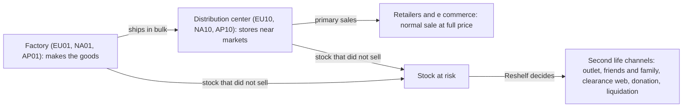

# Glossary

Plain language guide to the concepts, roles and flows behind Reshelf. It describes the demo world (Kestrel Beauty Group, all data synthetic). Where a description says what real planners do, it is a hypothesis **[H]** until interviews confirm it (see `product_management/1_discovery/`). All numbers are illustrative defaults from `data/scenarios/default.yaml`.

## 1. The problem in one paragraph

A cosmetics company makes more than it sells, or keeps selling products that age. Some stock cannot sell through the main retail channels anymore: it is too close to expiry, discontinued, obsolete, in excess, or overproduced. Left alone it gets destroyed. Reshelf decides where each unit should go instead (outlet, clearance website, donation, liquidation), under business rules, and explains why. Every unit not placed counts as destroyed.

## 2. Lot versus batch

| Term | Meaning | Where it lives | Who cares |
|---|---|---|---|
| **Batch** | One production run of one product. It has a batch number (`CHARG`), a production date (`HSDAT`) and an expiry date (`VFDAT`). It is a physical thing. | SAP table `MCHB` | Warehouse, quality, the law (traceability) |
| **Lot** | A group of batches that the model treats as one decision: same material, same plant, same expiry month. | Built by the canonical layer, not a source table | The optimizer |

Why two levels. Planners and warehouses think in batches. The optimizer would need one variable per batch, and that grows too large. Grouping by expiry month keeps the model small while remaining shelf life rules stay exact enough (decision ADR 003).

**Example from the generated default data** (the actual rows, material `100017`):

| Batch (`CHARG`) | Plant | Units | Produced | Expires |
|---|---|---|---|---|
| `B261200069` | `AP01` | 3,948 | 2024-06-07 | 2026-12-07 |
| `B261200070` | `AP01` | 14,808 | 2024-06-10 | 2026-12-10 |
| `B261200071` | `AP01` | 6,714 | 2024-06-07 | 2026-12-07 |

The product is "Brightleaf Aurore Hair Mask 250 ml", unit cost 2.33 euros. These three batches all expire in December 2026, so they form **one lot**: material 100017, plant `AP01`, expiry bucket `2026-12`, **25,470 units** (3,948 + 14,808 + 6,714). The expiry date of the lot is its earliest batch, 2026-12-07, so the model never overstates shelf life. The optimizer decides how many of those 25,470 units go to each channel. It does not split them by batch. A different batch of the same hair mask that expires in March 2027 would be a second lot.

A lot has a reason it is at risk (here `near_expiry`) and a remaining shelf life. See section 5.

## 3. Factories, distribution centers and the flow of goods

| Site | What it is | Why stock sits there |
|---|---|---|
| **Factory** | Where products are made (Łódź, Monterrey, Suzhou in the demo). Finished goods leave from here. | Overproduction waits here. Discontinued products are often left here. |
| **Distribution center (DC)** | A warehouse close to the markets (Rotterdam, Memphis, Singapore). It receives from factories and ships to customers. | Products that did not sell as forecast age here and get close to expiry. |

In SAP both are **plants** (`T001W`, key `WERKS`), told apart by a custom field. For the optimizer a plant is a place that holds lots. The plant matters for the shipping view and for the globe, not for the rules in v1. Every plant can ship to every channel in the demo. Freight cost and lead time are not modeled.

## 4. Roles

| Role | What they do | What they want from Reshelf | Tag |
|---|---|---|---|
| **Supply planner** (primary user) | Decides where stock goes. Keeps a spreadsheet of lots, expiry dates and channel limits. Applies a few rules by hand: is there enough shelf life left, is the brand allowed in that channel, is there room. | A defensible allocation in minutes instead of hours | [H] |
| **Demand planner** | Forecasts sales per product and market. Their forecast is an input to coverage needs. | Not a direct user. A source of demand data | [H] |
| **Brand manager / brand reviewer** | Protects the image of a brand. Challenges plans that put luxury products on a clearance website. | To see what a protective rule costs in euros | [H] |
| **Finance partner** | Owns the write off budget and the recovery value. Asks why units were destroyed. | A clear value recovered and units destroyed against a baseline | [H] |
| **Sustainability lead** | Wants fewer units destroyed and traceable donations. | Units diverted from destruction | [H] |
| **Channel owner** (outlet, web, NGO, liquidator) | Decides what their channel accepts and how much. Their limits become channel rules. | Not a user. A source of rules | [H] |
| **S&OP (sales and operations planning)** | The monthly cross team process that agrees supply, demand and stock actions. A good allocation is an S&OP decision. | A shared, auditable plan | [H] |

**What a supply planner does here, step by step** [H]:
1. Lists stock at risk by lot, with expiry date and value.
2. Checks which channels can still take each lot (shelf life, brand tier).
3. Fills channels by value, until a channel is full.
4. Reports the result to brand and finance, who challenge it.

What a spreadsheet struggles with are the rules that depend on each other across hundreds of products: SKU limits per channel, assortment limits per brand, coverage of channel demand, minimum pushes for new products. That is the gap the optimizer closes. The planner proxy baseline (ADR 005) models steps 1 to 3 with only the first three rules.

## 5. Stock and shelf life

| Term | Meaning |
|---|---|
| **Shelf life** | Total time from production to expiry. 24 to 36 months by category in the demo. |
| **Remaining shelf life (RSL)** | Share of the shelf life still left, in percent. Days to expiry divided by days of total life. |
| **RSL example** | The lot above expires 2026-12-07, produced 2024-06-07. Total life 913 days. On 2026-10-01 it has 67 days left, so RSL is 67 / 913, about 7%. |
| **Minimum RSL of a channel** | A channel will not take stock with less RSL than this (outlet 50%, clearance web 40%, donation 25%, liquidation 0%). The example lot, at 7%, can only go to liquidation. |
| **Stock reason** | Why the lot is at risk: `near_expiry`, `excess`, `obsolete`, `discontinued`, `overproduction`. A label for filters and the overview. It is not a solver input. |
| **ABC class** | Ranking of materials by sales. A is the top sellers (about 20% of SKUs, 80% of volume). B is the middle. C is the long tail. A SKU with no history is `NEW`. The class sets the material score. |
| **Unit cost** | Standard price per unit in euros (`MBEW`). |

## 6. Channels and rules

| Term | Meaning |
|---|---|
| **Channel** | A place to send the stock for a second life: outlet, friends and family sales, clearance website, NGO donation, liquidation partner. 20 channels in 12 countries in the demo. |
| **Brand tier** | Luxury, premium or mass. A channel accepts some tiers and not others. |
| **Elimination** | A (lot, channel) pair removed before the model runs because it fails shelf life (code `RSL`) or brand tier (code `TIER`). Each removal keeps its reason for the Why panel. |
| **Admissible pair** | A pair that survives elimination. |
| **Recovery factor** | Share of unit cost a channel pays back. |
| **Brand penalty** | Euros per unit charged against the brand image when a tier is sold in a channel. |
| **Capacity** | Most units a channel can take (rule `cap`). |
| **SKU limit** | Most distinct products a channel handles (rule `sku`). |
| **Group** | One brand in one category (for example Noctua Skincare). |
| **Assortment limits** | Most SKUs (`asrt`) and most units (`asrt_units`) of one group in one channel. |
| **Coverage** | Channels should hold enough of what they sell for a number of days. Upper bound `cov_hi`, lower bound `cov_lo`. |
| **Push** | A minimum quantity of a NEW product placed in a channel to launch it (rule `push`). |
| **Sell in / sell out** | Sell in is what we ship to a channel. Sell out is what the channel sells to consumers. Both history tables feed demand. |

## 7. Optimizer and explanation terms

| Term | Meaning |
|---|---|
| **Scenario** | A seed plus a full set of rule values. `default` and `luxury_protection` are the demo scenarios. |
| **Solver** | The program that finds the best allocation (HiGHS through PuLP). |
| **Constraint** | One named rule the solution must respect. 11 constraints, names stay stable because the Why panel reads them. |
| **Binding constraint** | A rule that is exactly at its limit, so loosening it would change the result. |
| **Phase 1 / phase 2** | Phase 1 keeps the most important SKUs selling (the score). Phase 2 then maximizes net value, giving up at most epsilon of the score. |
| **Epsilon** | The share of phase 1 score that phase 2 may give up (default 1%). |
| **MIP gap** | How close the solver can prove it is to the best possible answer. 0% means proven best. It is always shown. |
| **Greedy baseline / planner proxy** | A model of manual work: sort by value at risk, assign to the best channel with room, apply only shelf life, tier and capacity. The full checker then lists the rules it broke. It models a planner, it does not measure real ones. |
| **Raw value / compliant value** | Value of the baseline plan as signed, and its value after dropping lines that break rules. |
| **Rule trace** | After a solve, the list of binding rules and blocked channels for each allocation line. |
| **Counterfactual** | A re solve with one rule relaxed, to show what the rule costs in euros ("luxury protection costs X euros"). |
| **Net value** | Recovery minus brand penalty, in euros. The phase 2 objective. |

## 8. Data layers and SAP names

| Layer | What | Example |
|---|---|---|
| Source tables | SAP style tables as exported | `MARA` materials, `MCHB` batch stock, `MBEW` valuation, `T001W` plants |
| Custom tables | Added for Reshelf, prefix `Z` | `ZCHANNEL`, `ZSELLOUT`, `ZABC`, `ZPARAM` |
| Canonical dataset | Validated Python objects the solver reads | `Lot`, `Material`, `Channel` |

Field level mapping is in `mapping.md` and the diagrams in `erd.md`. A `ZZ` field is an append field a company adds to a standard SAP table (here brand, tier and stock reason).

## 9. Generator parameters

The meaning of each parameter is written next to it in `data/scenarios/default.yaml`. The statistical ones in short:

| Parameter | Meaning |
|---|---|
| `volume_sigma` | Standard deviation of the natural log of annual volume. Bigger means a few SKUs dominate. |
| `rsl_range`, `rsl_beta` | Where remaining shelf life falls for a stock reason: inside the range, shaped by a beta curve. |
| `qty_factor` | Lot size as a multiple of the SKU yearly volume. |
| `epsilon` | Phase 2 tolerance on the phase 1 score. |
| `coverage_alpha` | Lower bound on coverage, as a share of the need. |
